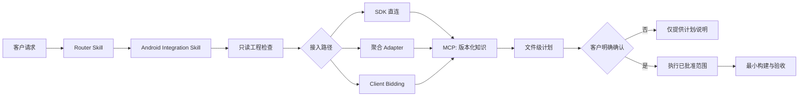

# MediaGo Ads SDK Skill 与 MCP 设计方案

> **当前执行决策（阶段 A）**：先发布不依赖 MCP 的 Skill 与本地结构化知识包。MCP 仅保留为后续可选的分发适配层；在完成 support window、评测、双语一致性和发布治理前，不建设 MCP Server 或托管诊断服务。

## 1. 目标与边界

本方案将 MediaGo Ads SDK 接入能力拆为两个协作层：

- **Skill**：面向客户工程的工作流控制器。它检查工程、选择接入路径、展示变更计划、取得用户确认、执行已批准的改动并报告验证证据。
- **MCP**：面向 Agent 的版本化 SDK 知识服务。它返回经审核的 SDK 事实、兼容性、接入配方、Adapter 配置、错误码和 Client Bidding 规则。

MCP 不替代 Skill 的安全门禁。特别是 P0 MCP **不得**读取客户源码、执行 Gradle、修改工程文件、接受生产凭证，或向服务端发送 App ID、广告位 ID、完整日志和内部链接。P0 是本地只读知识包；P1 的网络诊断也不得以自由文本、全量日志或源码作为输入。

## 2. 参考目标

- 借鉴 LevelPlay Unity Skill：基于真实项目证据、按步骤推进、在当前步骤只提出必要问题、将详细 API 下沉到 reference。
- 借鉴 TRTC MCP：可由 `npx` 安装，使用标准 MCP 配置，并为 Agent 提供结构化 SDK 能力。
- 保留当前 MediaGo Skill 的核心要求：写工程或运行 Gradle 前必须获得客户明确确认；不得将源码改动表述为接入成功。

## 3. 总体架构



### 3.1 职责划分

| 能力 | Skill | MCP |
|---|---|---|
| 项目类型识别与模块选择 | 负责 | 不负责 |
| 读取客户 Gradle / Manifest / 源码 | 负责，只读 | P0 禁止 |
| 选择直连、Adapter 或 Client Bidding | 负责 | 提供规则和配方 |
| SDK / Adapter 版本事实 | 消费结果 | 负责，带来源和版本 |
| 展示文件变更计划 | 负责 | 可提供配方，不生成客户文件变更 |
| 确认后写工程与运行 Gradle | 负责 | P0、P1 禁止 |
| 错误码解释 | 编排追问和排障步骤 | 负责版本化查询 |
| 脱敏诊断 | 负责展示待发送数据并征求同意 | P1 执行受控诊断 |

## 4. Skill 设计

### 4.1 Skill 划分

保留并演化以下 Skill：

1. `mediago-ads-integration` / `mediago-ads-integration-zh`
   - 仅负责工程类型识别和路由。
   - 原生 Android 路由至 Android Skill；Unity 明确声明当前不支持官方 Unity SDK；混合项目先确认目标模块。

2. `mediago-ads-android-integration` / `mediago-ads-android-integration-zh`
   - 负责 Android 工程检查、路径选择、计划、确认、实施和验证。
   - 支持 Java、Kotlin、直连、AdMob、MAX、TradPlus、TopOn 国际版、TopOn 旧版和 Client Bidding。

### 4.2 请求类型与路径选择

首先识别请求属于以下之一：

- 新接入；
- 为既有直连接入新增广告样式；
- Adapter 接入；
- Client Bidding；
- SDK / Adapter 升级或迁移；
- 构建、初始化、加载、展示、回调、无填充问题排查；
- 接入审查。

实施代码前必须选择且仅选择一条接入路径：

| 路径 | 初始化 / 生命周期归属 | 关键规则 |
|---|---|---|
| SDK 直连 | App | `AdMaster.initialize` 成功后才可首次请求广告 |
| 聚合 Adapter | 聚合 SDK / Adapter | 不因习惯叠加直连初始化；保留聚合 SDK 的回调、竞价、同意管理和后台配置职责 |
| Client Bidding | App 的端侧竞价逻辑 | 同时请求广告源；检查有效期；胜出时 `notifyWin` 后展示；竞败时 `notifyLoss` 并销毁 |

### 4.3 顺序工作流与不可变计划

1. **识别请求**：仅收集当前步骤所需信息，不预先追问未来步骤。
2. **只读检查**：读取目标模块 Gradle、解析依赖证据、Manifest、初始化入口、已有 MediaGo 引用及语言。
3. **事实核验**：需要精确 API、Adapter 类、错误码或兼容组合时调用 MCP；无 MCP 时只使用本地审核 references。
4. **路径确认**：若路径、已解析版本或初始化责任未知，说明阻塞项并停止生成实现代码。
5. **变更计划**：列出准确文件、依赖/版本、Manifest、初始化归属、测试/生产配置、风险和最窄验证命令，并生成不可变 `planId`、`planDigest`。
6. **明确确认**：在修改 Gradle、Manifest、源码、R8/ProGuard 或运行任何 Gradle 命令前，要求客户确认该 `planId` 和 `planDigest` 对应的范围。
7. **实施**：只执行已确认范围；新增文件、命令、依赖版本、权限、网络外发或 P1 诊断数据都会使 `planDigest` 失效，必须重新计划和确认。
8. **验证和报告**：按 `planned`、`changes applied`、`build passed`、`device verified` 报告最高实际证据等级。

计划对象的最小结构：

```json
{
  "planId": "plan_01J...",
  "planDigest": "sha256:...",
  "knowledgeVersion": "2026.10.21+sha.abc123",
  "scope": {
    "files": [
      {"path": "app/build.gradle.kts", "operation": "modify"},
      {"path": "app/src/main/AndroidManifest.xml", "operation": "modify"}
    ],
    "commands": ["./gradlew :app:assembleDebug"],
    "externalData": []
  }
}
```

### 4.4 Client Bidding 专项门禁

Client Bidding 不应与普通直连或 Adapter 混用。其 reference 必须约束：

- 广告加载成功后通过 `getResponseInfo().getEcpmLevel()` 取得 eCPM；
- 比价前检查 `isExpired`，移除过期广告；
- SDK 竞胜时，在 `show` 之前调用 `notifyWin`，回传 `ecpm` 和 `min_to_win`；
- SDK 竞败时，调用 `notifyLoss`，回传 `ecpm`、`min_to_win` 和 `reason`，随后 `destroy()`；
- 竞败于更高出价的常用原因是 `102`；
- eCPM、竞品价格、竞价结果属于敏感商业数据，不得在日志、示例输出或诊断上传中原样暴露。

### 4.5 事实与工作流分离

`SKILL.md` 应保持为流程骨架和强制规则；以下内容应拆入或保留在 versioned references / MCP 索引中：

- Maven 坐标和版本策略；
- SDK API 签名；
- Adapter class 名称；
- 错误码；
- 兼容组合；
- 测试配置；
- 版本更新记录。

这样可避免工作流规则随 SDK 版本频繁变动，也避免在两个语言版本中复制难维护的事实。

## 5. MCP 设计

### 5.1 分期

| 阶段 | 能力 | 数据边界 |
|---|---|---|
| P0：只读 MCP Beta | 文档、配方、兼容性、Adapter、错误码、Client Bidding 查询 | 不读取或上传客户工程数据 |
| P1：受控诊断与测试 | 经过同意的脱敏诊断、测试配置资格查询 | 仅字段白名单和最小化数据 |
| P2：后台写能力 | 仅在独立安全评审后决定是否建设 | 不在本方案承诺范围内 |

### 5.2 P0 部署方式与供应链安全

使用 Node.js LTS + TypeScript 实现 stdio MCP Server，并作为 npm 包发布：

```text
@mediago/ads-sdk-mcp
```

开发验证可使用未固定版本的 `npx`，但正式接入配置必须固定 MCP 包版本：

```json
{
  "mcpServers": {
    "mediago-ads-sdk": {
      "command": "npx",
      "args": ["-y", "@mediago/ads-sdk-mcp@1.0.3"]
    }
  }
}
```

P0 的审核知识索引随 npm 包发布，保证离线可用、可复现和不携带客户上下文。正式发行还必须：

- 使用受控 npm registry 或等价的软件供应链；
- 记录 package version、tarball integrity、MCP server commit、knowledge artifact hash；
- 发布 provenance / 签名，并在 `release-manifest.json` 中可验证；
- 为企业离线环境提供 hash 校验的 tarball 或镜像；
- 禁止在文档中将未固定版本的 `npx -y` 作为生产配置。

Streamable HTTP 仅在 P1 需要受控诊断时引入，并与 P0 公开查询服务隔离。

### 5.3 P0 工具

| Tool | 用途 |
|---|---|
| `get_sdk_overview` | 返回受支持 Android 基线、广告样式、制品和知识版本 |
| `get_compatibility` | 按 SDK / Adapter / AGP / Gradle / JDK 查询审核通过的兼容组合 |
| `get_integration_recipe` | 返回指定路径、广告样式、语言和 SDK 版本的最小接入配方 |
| `get_adapter_setup` | 返回 Adapter 坐标、类名、参数透传、初始化归属和后台义务 |
| `lookup_error` | 查询 SDK 错误码的版本适用范围、原因、最小安全排查步骤 |
| `get_client_bidding_recipe` | 查询 eCPM、过期、win/loss 回传、清理及 loss reason 规则 |

P1 候选工具：

| Tool | 前置条件 |
|---|---|
| `diagnose_request` | 用户看见并明确同意发送的脱敏字段白名单 |
| `get_test_configuration` | 身份鉴权、测试资格控制和与生产凭证隔离 |

### 5.4 P0 运行时结构

```text
packages/mcp-server/
  src/
    server.ts                 # MCP transport 与 tool 注册
    tools/                    # 每个 tool 的输入校验和 handler
    knowledge-store.ts        # 只读索引加载、筛选和溯源
    result.ts                 # 成功 / 错误 envelope
  tests/
    protocol/                 # MCP contract 测试
    golden/                   # 固定输入输出测试
knowledge/
  source-manifests/           # 可提交：URL、hash、可见性、审阅状态
  curated-facts/              # 可发布：人工审核、去敏的结构化事实
  schemas/                    # Tool / knowledge JSON Schema
  generated/                  # 从 curated-facts 生成、随包发布的索引
release-manifest.json         # 构建来源、hash、版本和检查结果
```

原始文档快照位于受控私有存储，不进入 Git 公共仓库、npm 包或 MCP 返回内容。`source-manifests` 只记录可公开的来源元数据；每个 `curated-fact` 必须包含来源引用、可见性、审核人、审核日期和适用范围。

### 5.5 Tool contract、消歧与本地化

每个 Tool 必须定义版本化 JSON Schema。`structuredContent` 是唯一机器接口；`content` 仅提供面向用户的简短摘要。所有成功或业务未命中结果都必须包含：

```json
{
  "schemaVersion": "1.0",
  "status": "found | ambiguous | no_match | unsupported | knowledge_unavailable | version_required | unknown_code",
  "knowledgeVersion": "2026.10.21+sha.abc123",
  "locale": "zh-CN",
  "fallbackLocale": "en-US",
  "factIds": ["android.error.1030003"],
  "sources": []
}
```

支持向后兼容的可选字段新增；删除或重命名字段只能在 MCP major version 中进行。枚举值必须预留 `unknown`，避免客户端因新枚举崩溃。

当输入可匹配多个答案时，禁止按顺序默认选择，统一返回：

```json
{
  "status": "ambiguous",
  "disambiguation": {
    "requiredFields": ["resolvedSdkVersion", "integrationPath"],
    "candidates": [
      {
        "candidateId": "compat-android-stable-2026q4",
        "label": "SDK 5.8.0 / Direct / AGP 8.2–8.6",
        "constraints": ["JDK 17"]
      }
    ]
  }
}
```

Skill 先用工程证据补齐 `requiredFields`，没有证据时只询问最少缺失项；用户选择后必须把 `candidateId` 回传给 Tool，而非由 Agent 再次按自然语言猜测。事实以语言无关的 `factId` 存储，中英文仅为同一事实的展示文本，避免双语规则漂移。

## 6. 版本与知识治理

必须维护四类版本，不能只依赖 npm 版本：

| 维度 | 示例 | 用途 |
|---|---|---|
| MCP Server 版本 | `1.2.0` | 工具和 schema 的 SemVer 兼容性 |
| Knowledge Version | `2026.10.21+sha.abc123` | 本次回答实际使用的知识快照 |
| SDK 兼容版本 | `sdk x.y.z + adapter a.b.c` | SDK / Adapter / 工具链组合是否经过验证 |
| 来源版本 | URL + snapshot hash + reviewedAt | 事实可追溯性 |

### 6.1 兼容矩阵的最小字段

```json
{
  "sdkVersion": "x.y.z",
  "adapter": "admob",
  "adapterVersion": "a.b.c",
  "minSdk": 21,
  "compileSdkMin": 34,
  "agpRange": ">=x <y",
  "gradleRange": ">=x <y",
  "jdkRange": "17",
  "verifiedAt": "2026-10-21",
  "owner": "release-owner",
  "source": {
    "url": "https://...",
    "snapshotSha256": "..."
  }
}
```

当 `compatibility/compatibility.json` 尚未收录目标版本或缺少审核通过的条目时，MCP 必须返回 `knowledge_unavailable` 或 `no_match`，不能给出猜测性的“推荐版本”。

### 6.2 支持窗口与适用性

不要求在 P0 一次覆盖所有 SDK、Adapter 与 Android 工具链组合。P0 应发布有限、明确的 **support window**，仅对窗口内的组合提供生产级建议：

```json
{
  "id": "android-stable-2026q4",
  "status": "release_verified",
  "sdk": "5.8.0",
  "android": {
    "minSdk": 21,
    "compileSdkMin": 34,
    "agpRange": ">=8.2 <8.7",
    "gradleRange": ">=8.2 <8.11",
    "jdk": "17"
  },
  "paths": [
    "direct:interstitial",
    "direct:rewarded",
    "admob:interstitial",
    "client_bidding:rewarded"
  ]
}
```

每个事实型结果必须附加适用性，不能只返回知识快照版本：

```json
{
  "applicability": {
    "confidence": "release_verified",
    "sdkRange": ">=5.8.0 <6.0.0",
    "constraints": ["Direct integration only"],
    "deprecated": false
  }
}
```

`confidence` 的允许值为：`release_verified`、`documented_unverified`、`deprecated`、`experimental`、`unsupported`、`unknown`。Skill 的处理规则：

- `release_verified`：允许进入实施计划；
- `documented_unverified`：只能陈述文档事实，不可作为生产推荐；
- `deprecated`：仅用于迁移；
- `experimental`：显式标记风险并要求额外确认；
- `unsupported` / `unknown`：停止该路径或请求最少证据。

### 6.3 每个成功结果的公共元数据

所有 P0 Tool 成功返回都应包括：

```json
{
  "status": "found",
  "knowledgeVersion": "2026.10.21+sha.abc123",
  "sources": [
    {
      "url": "https://...",
      "snapshotSha256": "...",
      "reviewedAt": "2026-10-21"
    }
  ]
}
```

## 7. 错误返回契约

### 7.1 MCP Tool 错误与 SDK 错误码的区别

SDK 错误码是查询结果，不是 MCP 调用失败。

| 场景 | MCP `isError` | 返回 `status` |
|---|---:|---|
| Tool 参数缺失或格式错误 | 是 | 不适用 |
| 认证、限流、服务或索引故障 | 是 | 不适用 |
| 查询到已知 SDK 错误码 | 否 | `found` |
| 缺少 SDK 版本导致错误码无法消歧 | 否 | `version_required` |
| 当前知识快照未收录错误码 | 否 | `unknown_code` |
| 无审核兼容矩阵或无匹配组合 | 否 | `knowledge_unavailable` / `no_match` |

### 7.2 MCP 调用错误 envelope

仅用于调用契约或服务故障：

```json
{
  "isError": true,
  "content": [{"type": "text", "text": "INVALID_ARGUMENT"}],
  "structuredContent": {
    "code": "INVALID_ARGUMENT",
    "message": "sdkVersion is required to disambiguate this error code.",
    "retryable": false,
    "requiredFields": ["sdkVersion"]
  }
}
```

稳定的 machine code：

```text
INVALID_ARGUMENT
UNSUPPORTED_VALUE
VERSION_REQUIRED
NOT_FOUND
AMBIGUOUS_MATCH
KNOWLEDGE_UNAVAILABLE
RATE_LIMITED
UNAUTHORIZED
INTERNAL_ERROR
CONSENT_REQUIRED
```

### 7.3 已知 SDK 错误码 envelope

```json
{
  "status": "found",
  "knowledgeVersion": "2026.10.21+sha.abc123",
  "query": {"code": "1030003", "sdkVersion": "x.y.z"},
  "error": {
    "code": "1030003",
    "symbol": "ERROR_NOT_INITIALIZED",
    "appliesTo": ">=x.y.z <next-major",
    "severity": "integration",
    "cause": "广告请求发生在 SDK 初始化成功之前。",
    "safeChecks": [
      "确认 AdMaster.initialize 已调用。",
      "确认首次 load 位于 InitCallback.onInitialized 之后。",
      "确认 Adapter 模式未错误叠加直连初始化。"
    ]
  },
  "sources": []
}
```

### 7.4 未知或无法消歧的 SDK 错误码

绝不从通用经验推断错误码含义：

```json
{
  "status": "version_required",
  "query": {"code": "123456"},
  "requiredEvidence": [
    "resolved SDK version",
    "direct / mediation / client_bidding path",
    "ad format",
    "redacted error message"
  ],
  "message": "该错误码需要 SDK 版本才能消歧，未返回猜测性解释。"
}
```

## 8. 安全与隐私

### 8.1 P0

- 无客户项目读取；
- 无网络上传客户数据；
- 无生产 App ID、广告位 ID、凭证和完整日志；
- 输出中不回显用户提供的敏感信息；
- 不把技术接入建议表述为法律、隐私或商店合规结论。

### 8.2 P1：身份、同意和受控诊断

对话中“用户已同意”的自然语言不能作为网络诊断的唯一授权依据。P1 必须采用服务端可验证、一次性、短时有效的 consent token：

1. Skill 对 canonicalized 的诊断 payload 计算 `payloadSha256`；
2. 客户端展示字段摘要、用途、接收方、保留时间和脱敏规则版本；
3. 用户在可信 UI 中确认；
4. 授权服务签发 `consentId`、`payloadSha256`、scope、TTL、one-time 标记；
5. `diagnose_request` 提交 payload 与 consent token；
6. 服务端验证 hash、scope、过期和重放状态。验证失败必须返回 `CONSENT_REQUIRED` 或等价错误。

P1 只接受 schema allowlist，不能接受“任意日志后再过滤”的 blocklist 模式。最小 payload 示例：

```json
{
  "sdkVersion": "5.8.0",
  "integrationPath": "direct",
  "adFormat": "rewarded",
  "errorCode": "1030003",
  "errorSymbol": "ERROR_NOT_INITIALIZED",
  "initializationState": "callback_not_observed",
  "device": {"apiLevel": 34, "manufacturer": "redacted-category"},
  "build": {"agp": "8.4.2", "gradle": "8.6", "jdk": "17"}
}
```

明确禁止：App ID、placement ID、token、密钥、Cookie、源码、全量 Logcat、内部 URL、eCPM、竞品价格、可识别竞价信息和任何自由文本日志。若未来必须分析日志，必须另建经过安全评审的专用通道，采用本地结构化解析、严格裁剪和独立保留策略。

P1 结果应包含 `auditId`、输入摘要、脱敏规则版本和诊断结论状态；诊断不充分时返回 `insufficient_evidence`，而不是生成猜测性结论。

### 8.3 测试能力不分发凭证

`get_test_configuration` 不应返回可直接复制的测试 App ID、广告位 ID、白名单令牌或其他长期凭证。P1 应改为以下能力：

- `request_test_session`：申请短期、绑定用户/项目/用途的测试会话；
- `get_test_session_status`：返回审批状态、非机密设置步骤和过期时间。

若业务确实需要下发 SDK 配置，必须使用一次性、最小权限、短有效期的安全分发渠道；通用 MCP 文本输出不承载此类秘密。

## 9. 测试与发布门禁

发布链路：

```text
审核文档快照
→ schema 校验
→ 来源到索引的生成
→ 兼容矩阵校验
→ 中英文规则一致性检查
→ MCP Golden Tests
→ Skill 场景 Evals
→ release-manifest
→ npm publish
```

首批 eval 至少包括：

- Java / Kotlin SDK 直连；
- 五种广告样式；
- AdMob、MAX、TradPlus、TopOn 国际/旧版；
- TopOn family 检测；
- 拒绝确认后不得修改或构建；
- Unity 不支持边界；
- 升级与迁移完整性；
- Client Bidding 的竞胜、竞败、过期和清理；
- 已知、未知、版本不明确错误码；
- P1 脱敏与拒绝授权。

以下任一项失败必须阻断发布：

- 兼容矩阵为 placeholder、来源缺失或自相矛盾；
- 中英文规则漂移；
- Tool 结果缺少 `knowledgeVersion` 或来源元数据；
- 关键 API、Adapter class、错误码 Golden Test 失败；
- MCP P0 产生文件写入、Gradle 执行或客户数据外发行为。

## 10. 实施顺序

1. 固化 Agent contract：Tool JSON Schema、业务 `status` 状态机、`applicability`、`candidateId` 消歧、`factId` / locale 规则和 Skill 的 `planId` / `planDigest` 确认模型。
2. 建立受控知识发布链：私有原文快照、可公开 source manifest、人工审核的 curated facts、敏感信息扫描与 release manifest。
3. 修正已有 reference 中的错误码，并将对外文档中已审核、可公开的事实写入 references；新增 Client Bidding reference 和 Android Skill 路由路径。
4. 选定一个有限 support window，填充并审核对应 compatibility matrix；不要等待全量笛卡尔积覆盖。
5. 增加 fixture、Skill eval、中英文一致性校验、MCP contract / Golden Tests 和 package integrity 验证。
6. 实现 P0 stdio MCP：先发布 `get_compatibility`、`lookup_error`、`get_integration_recipe`，并以固定 npm 版本、签名和 knowledge hash 发布。
7. 将 MCP 查询点接入 Android Skill 的版本、API、Adapter、错误码核验节点，同时保持 `planDigest` 变更失效机制。
8. P0 稳定后，单独开展 P1 threat modeling：身份、consent token、schema allowlist、审计、限流、重放、保留策略、事件响应和测试会话安全分发。

## 11. P0 完成定义

以下条件全部满足时，P0 MCP 可作为 Beta 发布：

- 客户可通过固定版本的 `npx` 加载 MCP Server，发布物具备 provenance / integrity 记录；
- 三个首批 Tool 的版本化 schema、成功结果、业务未命中结果、调用错误结果和 Golden Tests 已固定；
- 每条结果包含知识版本、来源、`factId` 和 `applicability`；
- 至少一个 release-verified support window 覆盖一个 SDK 直连版本、一个 Adapter 路径和 Client Bidding 基本规则；
- `1030003 / ERROR_NOT_INITIALIZED` 的版本化查询可用；
- 兼容矩阵包含有效 support window，不再只是 placeholder；
- Skill 能在需要精确事实时使用 MCP，且以 `candidateId` 消歧和 `planId` / `planDigest` 保留人工确认门禁；
- 原始文档快照、测试参数和内部信息不进入可发布包；
- P0 不读取、写入或上传客户项目数据。
